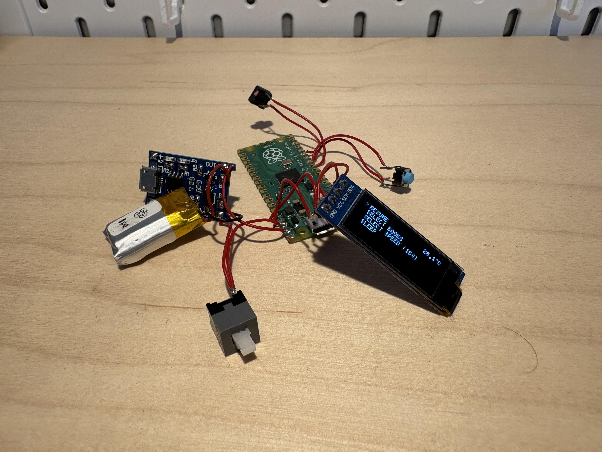
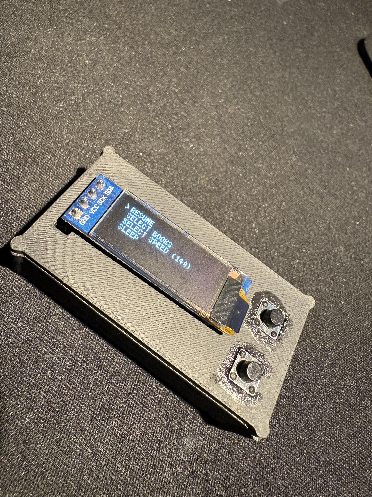

# Assembly guide

This guide describes a safe order of work. The exact fasteners, wire lengths, and power layout were not included, so use the photos as visual references and confirm each part against your own hardware.

1. **Inspect and print.** Review the three STL files in a slicer, confirm units and orientation, and print the top, middle, and bottom parts. Check fit before installing electronics.
2. **Identify modules.** Confirm the Pico pin labels, OLED connector order/voltage, battery polarity, and TP4056 terminal labels. Verify whether the charger module includes battery protection.
3. **Wire with power disconnected.** Connect the two buttons between GP10/GND and GP12/GND. Firmware uses internal pull-ups, so pressed reads LOW. Connect OLED SDA/SCL to the I²C pins appropriate for your selected board's default `Wire` mapping; this sketch does not explicitly assign them.
4. **Plan the battery path.** Follow the actual charging-module documentation and Pico power-input requirements. Do not connect battery positive to 3V3. Check polarity and continuity before inserting the battery.
5. **Test on the bench.** Power up without closing the enclosure. Verify the display, both buttons, charging behavior, and switch. Stop if anything heats, smells, or behaves unexpectedly.
6. **Fit into the enclosure.** Position display, buttons, board, battery, and charger as shown in the project photos. Keep wires clear of screw posts and sharp edges; avoid pinching the LiPo pouch.
7. **Close and retest.** Secure the three printed pieces using the fasteners suited to your actual design. Check button travel, USB access, and that the battery is not compressed.

