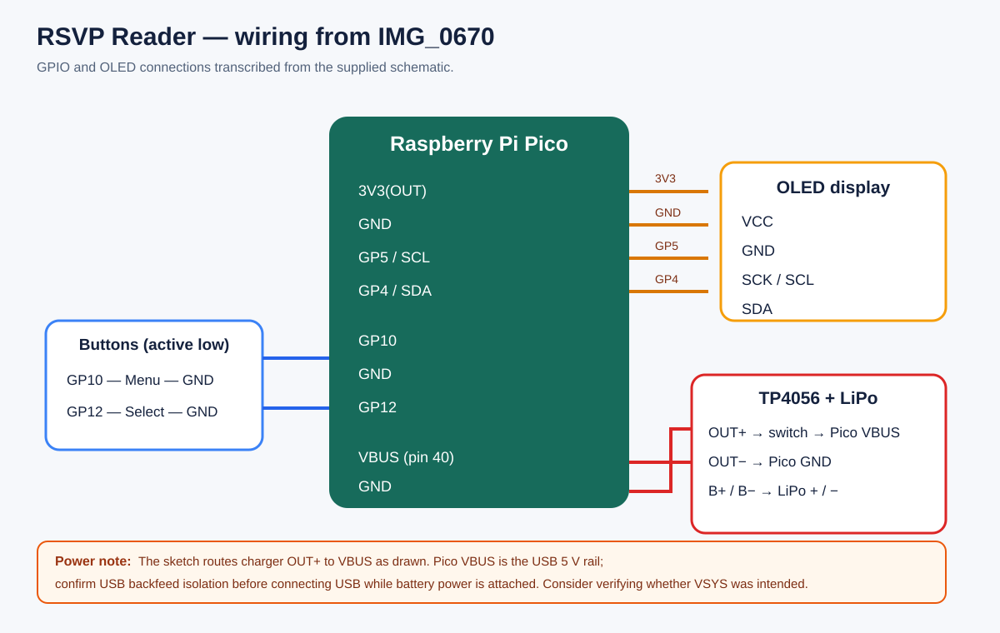

# Hardware and wiring (updated from IMG_0670.jpg)

## Pin map

| Pico connection | Component connection | Evidence |
|---|---|---|
| 3V3(OUT) | OLED VCC | Supplied schematic |
| GND | OLED GND | Supplied schematic |
| GP5 | OLED SCK/SCL | Supplied schematic; firmware uses `Wire.begin()` |
| GP4 | OLED SDA | Supplied schematic; firmware uses `Wire.begin()` |
| GP10 | Menu button, other contact to GND | Firmware constant and supplied schematic |
| GP12 | Select button, other contact to GND | Firmware constant and supplied schematic |
| VBUS, through a power switch | TP4056 OUT+ | Supplied schematic; verify USB power isolation |
| GND | TP4056 OUT− | Supplied schematic |
| TP4056 B+ / B− | LiPo positive / negative | Supplied schematic |

## Important power detail to verify

The hand-drawn schematic labels the Pico connection as **VBUS** and routes TP4056 `OUT+` through a switch to that pin. Raspberry Pi documents VBUS as the USB input rail (nominally 5 V) and VSYS as the main system input (1.8–5.5 V). Confirm the built wiring matches the drawing and prevents the battery/charger from feeding the USB connector when USB is attached. If the intended pin was VSYS, correct the wiring and documentation together. Do not treat VBUS and VSYS as interchangeable. See the [official Pico datasheet](https://datasheets.raspberrypi.com/pico/pico-datasheet.pdf).

The firmware configures the buttons with `INPUT_PULLUP`, so each button should pull its GPIO to GND when pressed.
