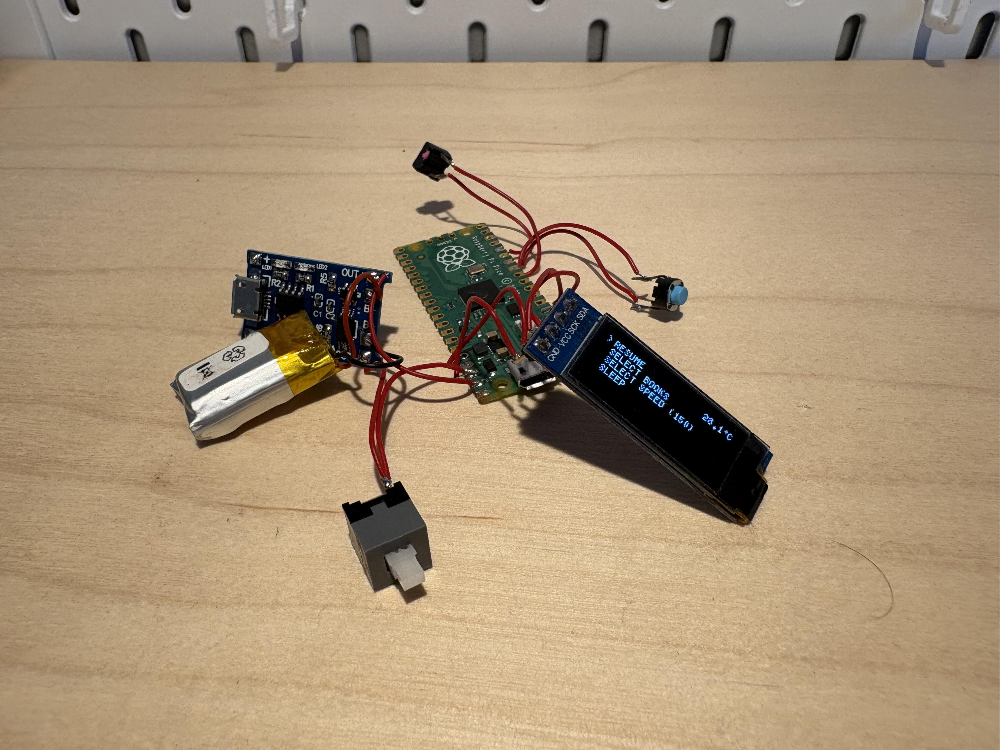
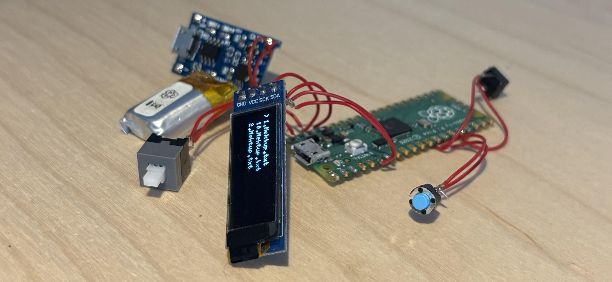
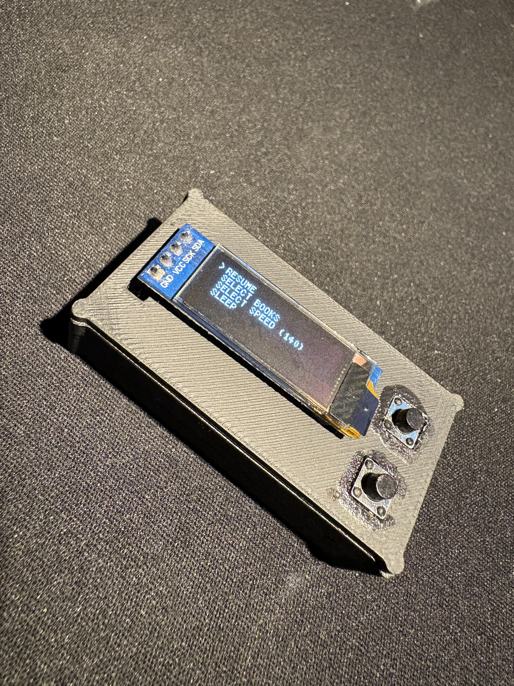
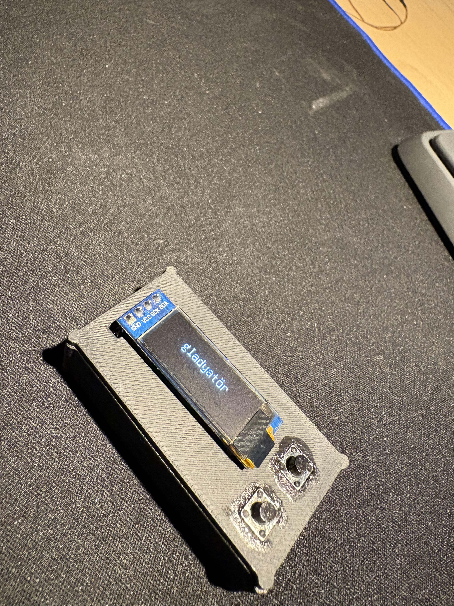

# RSVP Reader

A DIY handheld reader that presents text one word at a time using Rapid Serial Visual Presentation (RSVP). This build combines Raspberry Pi Pico firmware, an OLED display, two buttons, a rechargeable battery, and a custom 3D-printed enclosure.

> **Status:** Personal project release. The source files and photos are provided as-is. Please verify your exact board, display, charging module and wiring before powering a build.

See the [wiring diagram](Hardware/wiring-diagram.svg) and [hardware notes](Hardware/components.md).

## Features

- RSVP playback with selectable speeds from 140 to 200 words per minute (170 WPM default).
- Plain-text books stored in the Pico's LittleFS flash filesystem.
- Saved reading position, last book, and speed configuration.
- Book selection, pause/resume, rewind, restart, sleep, and menu navigation.
- Three-part 3D-printable enclosure; STL files are included.

## Hardware

| Part | Details |
|---|---|
| Microcontroller | Raspberry Pi Pico (RP2040), based on the firmware and project notes |
| Display | SSD1306 OLED, 128 × 32, I²C; firmware uses U8g2 `SSD1306_128X32_UNIVISION_F_HW_I2C` |
| Controls | Two momentary buttons |
| Battery/charging | 150 mAh LiPo and TP4056 charging module, per project notes; module protection and exact wiring must be confirmed against the actual parts |
| Enclosure | Three printed parts: bottom, middle, top |

See [the component list and wiring notes](Hardware/components.md). The [provisional wiring diagram](Hardware/wiring-diagram.svg) labels the I²C pin choice as a build assumption because the sketch calls `Wire.begin()` without explicitly assigning SDA/SCL.

## Repository layout

- `Firmware/RSVP_v13/` — publishable Arduino sketch.
- `Hardware/` — parts list, firmware-derived signal mapping, and wiring diagram.
- `3D-Print/` — STL files and print notes.
- `Images/` — photographs of the prototype and finished device.
- `Documentation/` — assembly and firmware installation instructions.
- `CHANGELOG.md` — initial release notes.

## Quick start

1. Gather the parts listed in `Hardware/components.md` and verify the pinout of your exact modules.
2. Print the three files in `3D-Print/`; review `3D-Print/README.md` before printing.
3. Assemble using `Documentation/assembly-guide.md`.
4. Install the Arduino-Pico board package and U8g2 library, then upload the sketch as described in `Documentation/firmware-installation.md`.
5. Put your own plain-text `.txt` books in a sketch `data/` folder and upload its LittleFS image. Book files are intentionally not included.

## Controls

The firmware defines the forward/menu button on GP10 and the play/select button on GP12. Both use `INPUT_PULLUP`, so each button connects its GPIO to GND when pressed. The exact action depends on the current screen; both buttons held together wake the device from sleep.

## Safety and data

- Check battery polarity and the charging board pin labels before connecting a LiPo. Do not charge a damaged or swollen cell.
- Do not connect a LiPo directly to the Pico's 3V3 pin. Confirm the power path and switch wiring against your actual module and board.
- Uploading a LittleFS image replaces the filesystem image and can erase books and saved progress. Keep backups and follow the installer guide.
- Only add text you have permission to store and distribute. Personal book files are not part of this repository.

## License

The project is released under the MIT License; see [LICENSE](LICENSE). Third-party libraries retain their own licenses.

## Credits

- Arduino-Pico core by Earle F. Philhower, III: https://github.com/earlephilhower/arduino-pico
- U8g2 by olikraus: https://github.com/olikraus/u8g2

